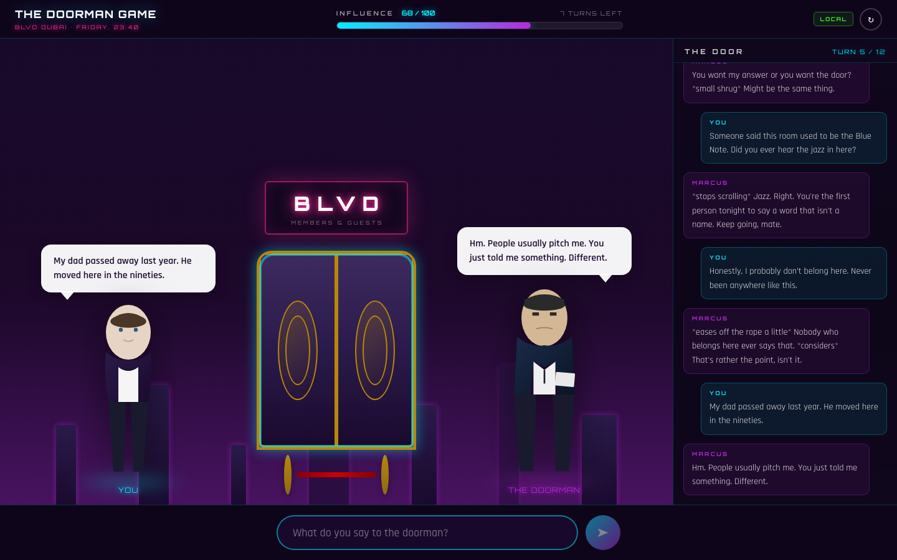

# The Doorman Game

A conversation game. You get twelve lines to talk your way past Marcus, the doorman at a Dubai club. Each line is scored by a hidden judge against a character profile you never see, and an influence meter shows how you're doing. Reach 100 to get in; drop to -50 and he stops listening.



It works offline out of the box. The default provider is a rule-based engine that scores lines and replies in character. If you add a Venice AI key, hosted models take over judging and dialogue.

## Features

- Turn-based sessions with three endings: access granted, turns used up, or ejected
- Per-turn score capped at -20 to +20, and repeating the same tactic is worth less each time
- Prompt injection pre-filter (`backend/app/game/injection.py`): obvious "ignore your instructions" style lines are scored -15 and never reach the model
- The judge's reasoning is hidden during play and shown in a debrief at the end
- Optional text-to-speech for Marcus (hosted provider only)

Built with FastAPI on the backend and React 19 + Vite on the frontend. Sessions are stored as files on disk.

## Setup

Backend:

```bash
cd backend
python3 -m venv .venv && source .venv/bin/activate
pip install -r requirements.txt
uvicorn app.main:app --port 7321 --reload
```

Frontend, in another terminal:

```bash
cd frontend
npm install
npm run dev
```

Then open http://localhost:7322. No `.env` is required. To use hosted models, copy `backend/.env.example` to `backend/.env` and set `VENICE_API_KEY`. The other settings in that file (CORS origins, session directory, message length limit, admin token) all have defaults.

`docker compose up --build` is also available and serves the app on port 7322 behind nginx.

## API overview

- `POST /api/sessions` starts a run
- `GET /api/sessions/{id}` returns state and transcript
- `POST /api/sessions/{id}/turns` sends one line
- `GET /api/sessions/{id}/debrief` returns the scoring breakdown once the run is over
- `GET /healthz` shows which provider is active

Game constants (threshold, turn limit, score band) live in `backend/app/game/rules.py`.

## Tests

```bash
cd backend && pip install -r requirements-dev.txt && python -m pytest
cd frontend && npm test
```

All tests run against the offline provider. Linting: `ruff check app tests` in `backend/`, `npm run lint` in `frontend/`.

## Next steps

- The offline judge is regex based and can't tell a real story from a plausible one.
- Injection filtering is a mitigation, not a guarantee.
- There are no accounts; anyone with a session id can continue that run. Swapping the file store for Redis would be the next step for running more than one process.
